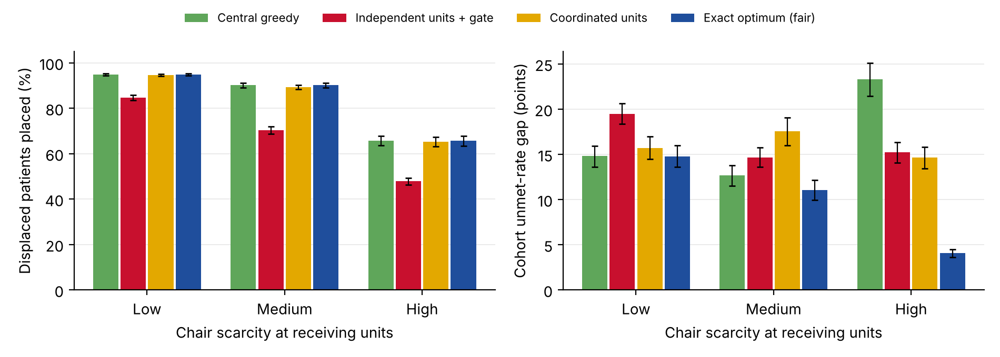

# DialysisFlow-AgentBench v0.2.0

**Re-placing displaced dialysis patients after a unit closure: independent unit agents, coordinated agents and an exact optimum on 1,200 synthetic networks**

> Research benchmark on **synthetic operational data only**. It models chairs, shifts, travel time and a shared transport fleet. It holds no patient data, no clinical information and makes no clinical or treatment decisions.

## Question

When one dialysis unit closes some or all of its shifts, its patients must be placed in free chairs at nearby units. Can receiving units acting as separate agents do this as well as a central planner? Does coordination through a shared ledger close the gap? How far are simple policies from the exact optimum on the number of patients placed and on the gap between patients who need transport and those who travel independently?

## Model

Each scenario is generated from its own seed:

- 4 to 6 receiving units, 8 to 16 chairs each, four shifts (MWF morning and afternoon, TTS morning and afternoon).
- Chairs already in use: 60–75% (low scarcity), 75–85% (medium) or 85–95% (high).
- The closed unit loses two shifts (partial) or all four (full); 80–100% of its chairs were occupied.
- About 35% of displaced patients need transport. They can travel at most 45 minutes and each needs a seat in the shared transport fleet for their shift. Independent patients can travel at most 75 minutes.
- A patient keeps their weekday pattern. Moving between morning and afternoon is allowed and adds a burden of 20 minutes.

1,200 scenarios: 3 scarcity levels × 2 severities × 200 seeds.

## Policies

| Policy | What it does |
|---|---|
| `list_order_greedy` | Central planner; patients in list order, each to the lowest-burden free option |
| `most_constrained_greedy` | Central planner; patients with the fewest options first |
| `independent_units` | Each unit offers its own chairs, nearest patients first, in one round, and books transport as if no other unit used the fleet |
| `independent_units_gated` | The same proposals checked against the shared fleet before commit; bookings that do not fit are dropped |
| `coordinated_units` | Rounds of offers against a shared ledger; patients accept their best offer and units re-offer what is left |
| `optimal_throughput` | Exact MILP: most patients placed, then least burden |
| `optimal_fair` | Exact MILP: highest placement rate for the worse-off cohort, then most placed, then least burden |

No policy has errors added on purpose (v0.1.0 did; see CHANGELOG). The only source of infeasible plans is units acting on their own view of the shared transport fleet.

## Results (1,200 scenarios, 95% bootstrap intervals over scenarios)

| Policy | Placed (%) | Unmet, transport (%) | Unmet, independent (%) | Cohort gap (points) | Mean burden (min) | Feasible plans (%) |
|---|---|---|---|---|---|---|
| list_order_greedy | 83.3 [82.2, 84.3] | 25.5 | 12.1 | 15.5 [14.7, 16.2] | 30.9 | 100 |
| most_constrained_greedy | 83.6 [82.5, 84.6] | 17.5 | 16.0 | 16.9 [16.1, 17.8] | 30.5 | 100 |
| independent_units | 70.4 [69.1, 71.7] | 30.6 | 29.1 | 11.8 [11.1, 12.4] | 22.8 | 52.2 |
| independent_units_gated | 67.6 [66.4, 68.8] | 38.7 | 29.1 | 16.4 [15.7, 17.1] | 22.9 | 100 |
| coordinated_units | 83.0 [81.9, 84.1] | 26.0 | 12.2 | 16.0 [15.2, 16.7] | 26.1 | 100 |
| optimal_throughput | 83.6 [82.5, 84.6] | 23.9 | 12.5 | 13.8 [13.1, 14.4] | 25.0 | 100 |
| optimal_fair | 83.6 [82.5, 84.6] | 21.7 | 13.6 | 10.0 [9.4, 10.6] | 25.0 | 100 |

Full intervals: `results/summary.md` and `results/results.json`.



What the numbers show:

1. **Independent units lose patients.** In one round they placed 70.4% against 83.6% at the optimum (paired difference −13.2 points, 95% CI −13.9 to −12.4) and overbooked the transport fleet in 47.8% of scenarios. A safety gate made every plan feasible but placed even fewer (67.6%): the gate removes bad bookings, it does not find new places.
2. **Coordination recovers almost all of it.** Rounds of offers against a shared ledger placed 83.0%, within 0.5 points of the optimum, at about one extra minute of burden per patient.
3. **Placing as many as possible is easy here; fairness is not.** Both greedy planners matched or nearly matched the optimal number placed, but the cohort gap was 15.5–16.9 points against 10.0 for the fair optimum, and under high scarcity 23.3 against 4.1. Only the fair objective kept patients who need transport from falling behind.
4. Maximising the worse-off cohort cost nothing in patients placed and almost nothing in burden compared with the throughput optimum.

## Paper

`paper/main.pdf`: *Separate Units Lose Patients, Greedy Planners Lose Fairness: Re-placing Dialysis Patients After a Unit Closure* (LaTeX source in `paper/`).

## Run

```bash
python3 -m venv .venv && source .venv/bin/activate
pip install -r requirements.txt
pytest -q
python3 run_benchmark.py            # 1,200 scenarios, about 90 seconds on a laptop CPU
```

`--per-cell N` changes the number of seeds per scarcity × severity cell; `--seed` the first seed.

## Files

- `dialysisflow/network.py`: seeded scenario generator
- `dialysisflow/policies.py`: the seven policies, including the exact MILP (SciPy/HiGHS)
- `dialysisflow/evaluate.py`: scoring, paired bootstrap, outputs
- `results/`: per-scenario rows, summary, `results.json`, chart

## Limitations

- Synthetic networks. Chair counts, occupancy, travel limits, transport share and fleet size are illustrative, not taken from any service.
- Travel is straight-line distance converted to minutes. There is no road network, traffic or multi-day planning.
- The two cohorts are an operational construct (needs transport or not). The cohort gap is not a validated social or clinical fairness measure.
- Unit agents are rule-based. No language-model agents are evaluated in this version.
- Clinical priority, infection control, staffing rules and patient preference are not modelled.

## Related work

Dialysis scheduling has been studied with exact optimisation, for example patient and technician scheduling (Farhadi, Ansari and Jara-Moroni, *Health Care Management Science*, 2023, doi:10.1007/s10729-023-09642-7) and branch-and-price appointment scheduling (Reihaneh, Ansari and Farhadi, *European Journal of Operational Research*, 2023, doi:10.1016/j.ejor.2023.01.024). This benchmark looks at a different setting: one-off re-placement after a closure, and what is lost when the receiving units decide separately.

## Citation and licence

See `CITATION.cff`. Code: MIT licence.
